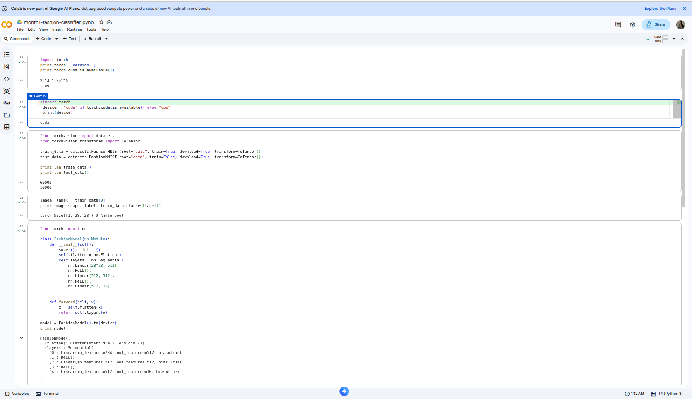
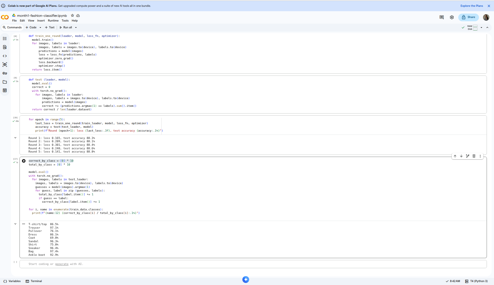
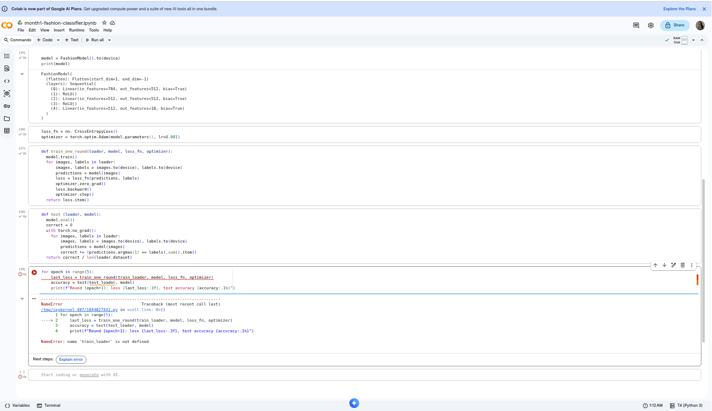

# Month 1 - FashionMNIST Image Classifier

A small neural network, built and trained in PyTorch, that looks at 28×28 greyscale pictures of clothing and decides which of 10 clothing types each one is.

This is the first model in my 12-month AI Security Engineering training. I built it so I understand how models learn before I start attacking and defending them (Domain 2 onwards).

---

## 1. What it does

- **Input:** a 28×28 greyscale image of a clothing item (from the FashionMNIST dataset).
- **Output:** one of 10 classes - T-shirt/top, Trouser, Pullover, Dress, Coat, Sandal, Shirt, Sneaker, Bag, Ankle boot.
- **Data:** 60,000 training images the model learns from, and 10,000 test images kept hidden until evaluation.

## 2. How it learns

### The model (an assembly line)

```
image (28×28 grid)
   │  Flatten - unroll the grid into one line
   ▼
784 numbers (one per pixel)
   │  Linear 784 → 512, then ReLU
   ▼
512 numbers
   │  Linear 512 → 512, then ReLU
   ▼
512 numbers
   │  Linear 512 → 10
   ▼
10 scores - the highest score is the model's guess
```

- **Flatten:** turns the 28×28 grid into a line of 784 numbers so the layers can read it.
- **Linear layer:** each neuron looks at every incoming number, multiplies each by a **weight** (a learnable knob), adds them up, plus a **bias**.
- **ReLU:** keeps positive values and turns negatives into 0, so the network can learn non-straight-line patterns.
- **Why these sizes:** 784 is fixed by the image (28 × 28); 10 is fixed by the number of classes; 512 is a design choice (the size used in the official PyTorch tutorial).
- **Total learnable parameters:** 669,706.

### Training (predict → measure → adjust → repeat)

1. Feed a batch of 64 images through the model and get its guesses.
2. Measure how wrong the guesses are with **cross-entropy loss**.
3. Work out which way to nudge each weight (`loss.backward()`), then nudge them with the **Adam** optimiser (learning rate 0.001).
4. Repeat for every batch in the 60,000 training images = one round (epoch). Train for 5 rounds.
5. After each round, test on the 10,000 hidden images and count correct guesses.

## 3. Results

**Setup:** PyTorch 2.14.1 (CUDA build), Google Colab T4 GPU, seed 42, batch size 64, Adam (lr = 0.001), 5 epochs.

**Final test accuracy: 87.9%** - reproducible: two full runs from a fresh session gave identical results.

| Round | Test accuracy |
|---|---|
| 1 | 84.9% |
| 2 | 86.3% |
| 3 | 86.6% |
| 4 | 87.5% |
| 5 | 87.9% |

**Accuracy per class (seed 42):**

| Class | Accuracy |
|---|---|
| Bag | 98.4% |
| Sandal | 96.7% |
| Trouser | 96.0% |
| Ankle boot | 95.5% |
| Sneaker | 94.6% |
| Dress | 90.8% |
| Pullover | 85.3% |
| T-shirt/top | 83.1% |
| Coat | 72.6% |
| **Shirt** | **66.3%** |

**What this shows:** the model is strong on items with distinctive shapes (bags, footwear, trousers) and weak on upper-body garments (shirt, coat, T-shirt, pullover), which look alike at 28×28 in greyscale. The overall 87.9% hides a class the model gets wrong one time in three.

> Note: the printed loss is from the last batch of each round only, so it jumps around. Test accuracy is the reliable measure.
**The working notebook** after a fresh "Restart session and run all" (seed 42):





## 4. What broke and how I fixed it

| Symptom | Cause | Fix |
|---|---|---|
| Syntax errors (missing commas, colons, brackets; wrong indentation) | Typing mistakes while writing the code by hand | Read the error line Colab pointed to and corrected the code |
| `NameError: name 'train_loader' is not defined` | The cell that creates the DataLoaders had not been added/run | Added the DataLoader cell before the model and ran the notebook top to bottom |
| Round 1 accuracy was 88% instead of about 84% | I re-ran only the training cell, so it kept training an already-trained model; the seed had no effect | Runtime → Restart session and run all |
| Results changed every run | Random starting weights and shuffling | Set `torch.manual_seed(42)` at the top, before anything random happens |
**The break:** the training loop asked for `train_loader`, which didn't exist yet, because the DataLoader cell had not been run.



## 5. What I learned

- **Overfitting is memorising, not learning.** Like a student who memorises a question bank: perfect on familiar questions, poor on new ones. That is why the 10,000 test images stay hidden during training.
- **Test set vs validation set:** the test set is the final exam; a validation set is a separate slice used to tune choices such as layer size during training.
- **One accuracy number can mislead.** Always check accuracy per class. The weakest classes also changed between seeds (Pullover went from about 76% to 85%), so serious evaluation tests several seeds and averages them.
- **Reproducibility matters.** Fixing the seed lets anyone get my exact numbers, and lets me compare changes fairly.
- **Notebooks run in order.** A notebook only remembers cells run in the current session, in sequence.

## 6. Security angle

How an attacker could target a model like this:

- **Data poisoning:** slip mislabelled images into the training data so the model learns the wrong thing.
- **Evasion (adversarial examples):** add tiny pixel changes a person can't see so the model misclassifies an image, e.g. a shirt as a bag.
- **Model theft:** steal the saved weights file (`fashion_model.pth`), or query the model thousands of times and train a copy from its answers (*model extraction*).
- **Malicious model files:** `.pth` files use Python pickle and can carry hidden code that runs when loaded. Only load trusted files, with `torch.load(path, weights_only=True)`.

The weak classes (Shirt, Coat) are where an attacker would push first. I will attack this model in Domain 2.

## 7. How to run it

1. Open `month1-fashion-classifier.ipynb` in [Google Colab](https://colab.research.google.com).
2. **Runtime → Change runtime type → T4 GPU.**
3. **Runtime → Run all.** Cells must run top to bottom.
4. Expected result: 87.9% test accuracy (seed 42). A tiny difference on a GPU is normal.

To load the saved model:

```python
model = FashionModel().to(device)
model.load_state_dict(torch.load("fashion_model.pth", weights_only=True))
model.eval()
```

## Files

| File | What it is |
|---|---|
| `month1-fashion-classifier.ipynb` | The notebook: data, model, training, evaluation |
| `fashion_model.pth` | Trained weights (seed 42, 87.9%) |
| `README.md` | This file |

## Next experiments

- Change the hidden size from 512 to 128 and compare accuracy.
- Run seeds 1–5 and report the average and spread.
- Try a convolutional network (CNN), which can see shapes, and check whether Shirt and Coat improve.

---

*Built by hand in Colab as part of my 12-month AI Security Engineering training. README drafted by me and reviewed with AI assistance.*
